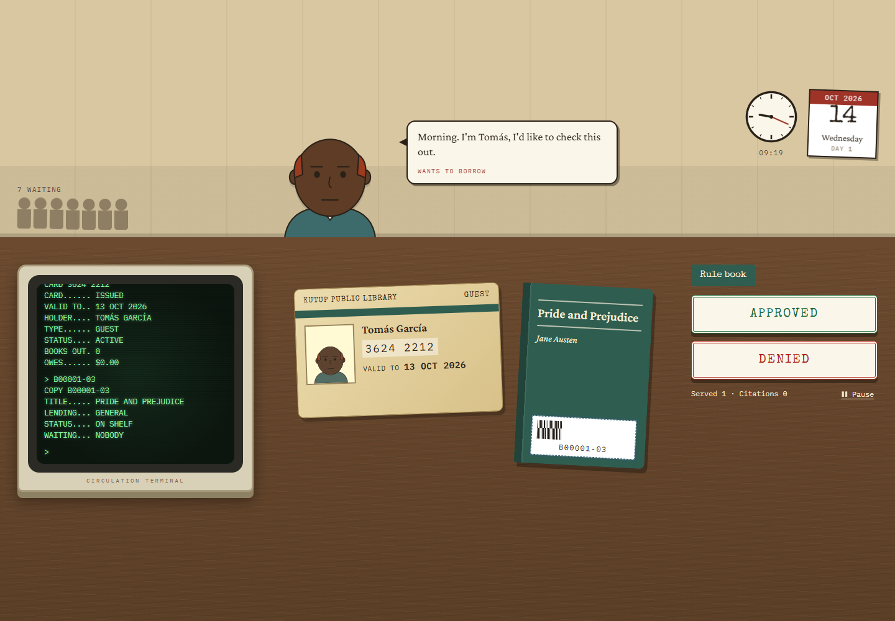
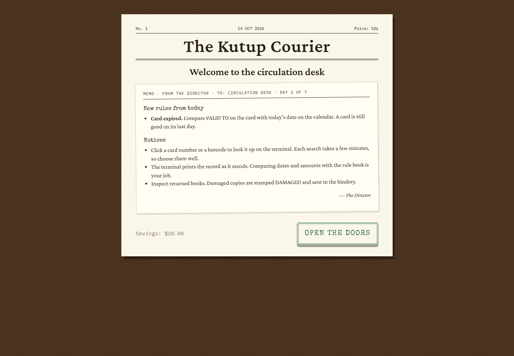
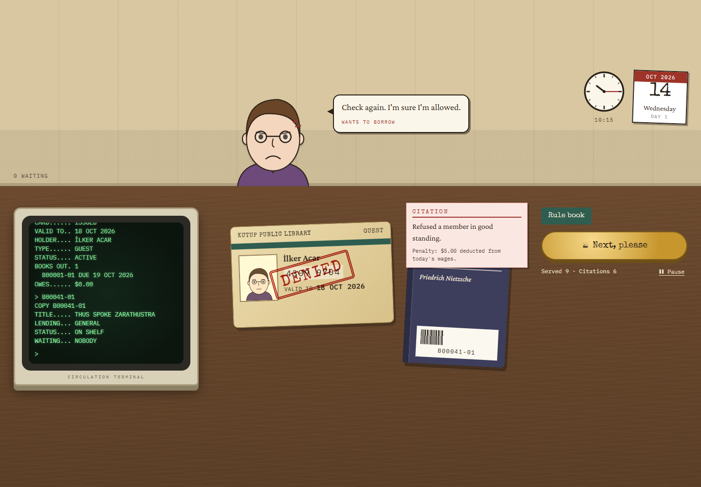
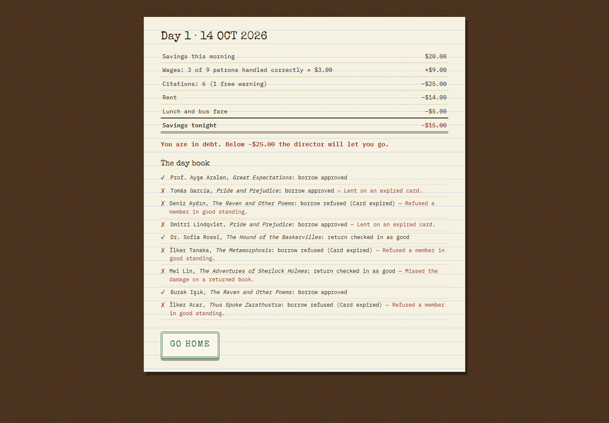
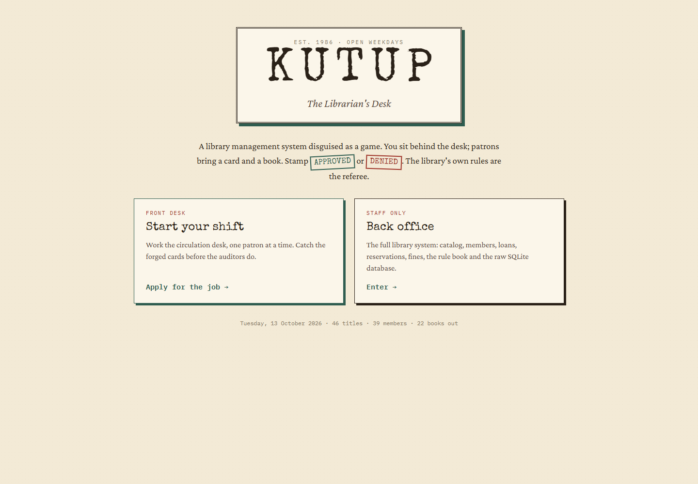
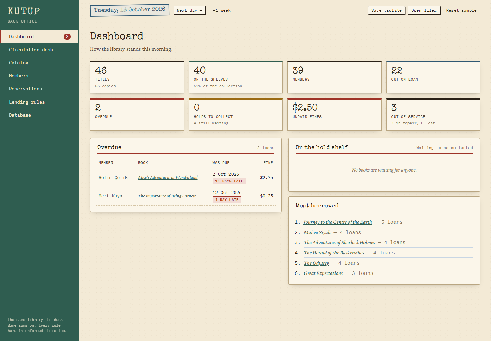
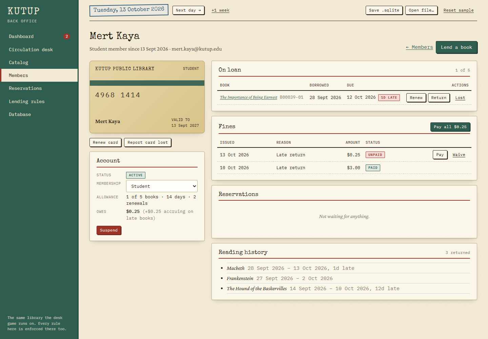
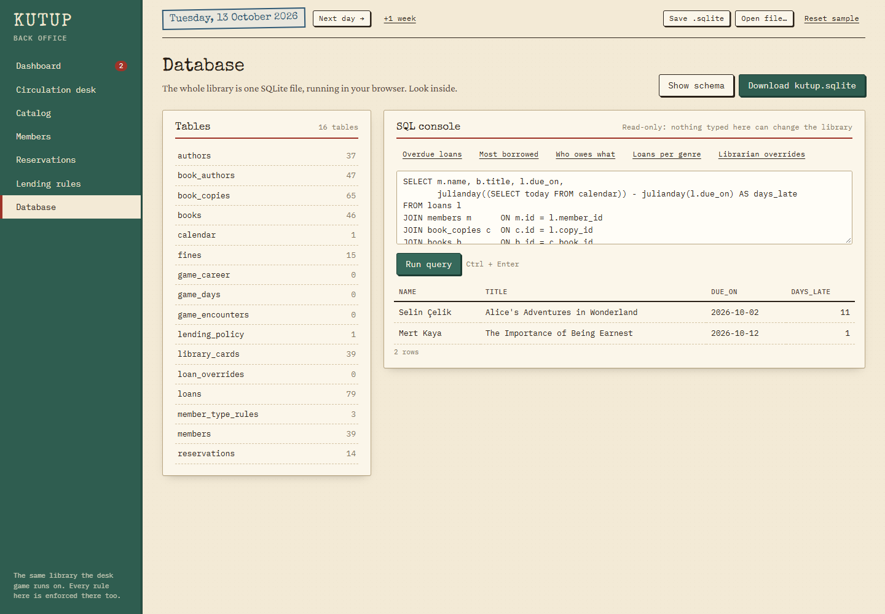

# Kutup: The Librarian's Desk

[](https://github.com/EmiRZx/kutup/actions/workflows/ci.yml)

A library management system disguised as a game.

**[Play it in the browser →](https://emirzx.github.io/kutup/)** Nothing to install: the whole library, SQLite
database included, runs in your browser.



Underneath is a complete, conventional library system: catalog, members, cards,
loans, reservations and fines, stored in a real SQLite database. On top of it
sits a *Papers, Please*-style desk game in which you are the librarian. Patrons
walk up with a card and a book, and you stamp **APPROVED** or **DENIED**. The
library core acts as the referee: it checks every decision you make against
the same rules the admin panel enforces.

## The desk game

A seven-day career at the circulation desk, in the spirit of *Papers, Please*.

- **Each morning** the director's memo introduces new rules: expired cards on day 1, borrowed and forged
  cards on day 2, unpaid fines and overdue books on day 3, and so on, up to exam week (students limited to
  three books) and inspection day.
- **At the desk** patrons walk up one at a time with a card and a book. Some things you can see (the expiry
  date, the photo, a red REFERENCE sticker, a hold slip with someone else's name); the rest you have to look
  up on the green-screen terminal (forged numbers, lost cards, unpaid fines, overdue books, renewal counts).
- **The terminal prints the record, never the verdict.** It won't say a card has expired or a book is late:
  you compare the dates with the calendar on the wall and the amounts with the rule book. Every search
  costs four minutes of a working day that only gets busier, from 9 patrons on day 1 to 18 on day 7.
- **Not everyone suspicious is guilty.** Decoys stand right next to a rule (a card on its last day, fines
  just under the limit, one book short of the limit, the last allowed renewal), and refusing them costs you
  as much as letting a forger through. People using a borrowed card look like its owner, and some give
  the owner's name.
- **You stamp APPROVED or DENIED**, citing the rule when you refuse. Returns are stamped RECEIVED or DAMAGED
  after you inspect the book for coffee rings and torn covers.
- **The library core is the referee.** Your decision is carried out through the same services the back office
  uses and graded against the core's own verdict. Lending against the rules still goes through, but it is
  recorded as a librarian override with the broken rules attached, and you get a citation.
- **Every evening** wages, citation penalties and a growing pile of bills are settled. Fall too far into debt and you're
  fired; survive the week for a performance review, then keep working for as long as you like.

Patrons are not scripted. Each one is built from the library's real state (an actual member, their actual card
and account, a copy that is really on the shelf) and checked against the core before they reach the desk, so
every troublemaker breaks exactly the rule their story is about, and never one you haven't been taught. While
you're at home, the rest of the town keeps borrowing and returning books, so tomorrow's queue grows out of
today's library. The whole career is saved in the same SQLite file as the library.

<p>
  
  
</p>
<p>
  
  
</p>

## The back office

A complete library administration app on top of the same core:

- **Dashboard**: collection figures, overdue loans with accrued fines, the hold shelf, most borrowed titles.
- **Circulation desk**: type a card number and a barcode and every lending rule is checked as you type. Librarians
  can override soft rules with a written reason, which is kept on the loan record.
- **Catalog** and **Members**: add titles and copies, register members, manage cards, renewals, fines and reservations.
- **Lending rules**: edit the policy; changes apply to the next request.
- **Database**: browse every table, read the schema, and run read-only SQL against the live library.
- **Calendar**: the library runs on its own calendar. *Next day* advances it, so loans fall due and holds expire.

The library is saved in the browser automatically, and can be downloaded as (or opened from) a `.sqlite` file.

<p>
  
  
</p>
<p>
  
</p>

## Built with

TypeScript (strict), React 19 and Vite; SQLite compiled to WebAssembly ([sql.js](https://sql.js.org)) for the
database; Vitest for unit and integration tests; Puppeteer driving Chrome for end-to-end tests and screenshots;
GitHub Actions for CI and deployment to GitHub Pages. No UI framework and no backend.

## Architecture

```
src/core/   Domain model and services in pure TypeScript (no UI, no database)
  model/      Book, BookCopy, Author, Member, LibraryCard, Loan, Reservation, Fine, LendingPolicy
  services/   CatalogService, MemberService, LendingService, ReservationService, FineService
  Library.ts  Facade that wires the services together
src/db/     SQLite (sql.js / WebAssembly) implementation of the core's repository interfaces
src/sim/    Background library life: patrons borrowing, returning and paying, through the public services
src/game/   The desk game in pure TypeScript: campaign, scenario builders, judge, economy, terminal
src/ui/     React app: title screen, desk game and back office (hash routing, no UI framework)
tests/      Vitest suites for the core, the database and the game
scripts/    Browser end-to-end test and screenshot tool (Puppeteer + local Chrome)
.github/    CI: lint, tests, build and end-to-end tests on every push; deploys main to GitHub Pages
```

- **The core never touches the database directly.** It depends on repository
  interfaces (`src/core/repositories.ts`), and `src/db` implements them with SQLite.
- **The core never reads the system clock.** It asks a `Clock`, so tests and
  the game can run the library on their own calendar.
- **Rules are data.** `LendingPolicy` is an immutable value object stored in the
  database; the game changes the rules day by day.
- **Invalid states can't be saved.** Entities guard their own state machines
  (a lost copy can't be lent), and the schema backs this up with `CHECK`,
  `UNIQUE` and foreign-key constraints.
- **The save file is the database.** The whole library exports as a single
  `.sqlite` file that any SQLite browser can open.
- **The game never bypasses the library.** It only decides who walks up to the
  desk; every change to the library goes through the core's services, so the
  back office always shows a consistent library, overrides and all.
- **The game is tested by playing it.** The test suite plays a full career as a
  perfect librarian (who must never be cited), as one who approves everything
  (who must be), and as one who refuses everyone (who must be fired), checking
  on every patron that the scenario is fair.

## Getting started

```bash
npm install
npm run dev        # start the app
npm test           # unit and integration tests
npm run typecheck
npm run build

# against a running build (npx vite preview --port 4173):
npm run e2e          # end-to-end checks in headless Chrome
npm run screenshots  # capture every screen into ./screenshots
```
